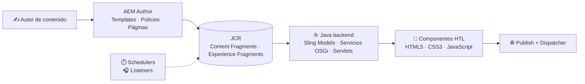

  

  

  
  
  

---

## 👋 Sobre mí

Soy desarrollador **Java** con experiencia real en **Adobe Experience Manager**, donde me siento más cómodo en el backend: lógica de negocio, servicios y automatización sobre una plataforma empresarial.

- 🎓 **Técnico Superior en Desarrollo de Aplicaciones Web (DAW)** · U-tad
- 💼 **AEM Developer en Minsait** (prácticas, marzo – junio 2026): desarrollo full stack con Java sobre *AEM as a Cloud Service*
- ☕ Backend con **Sling Models, servicios OSGi, servlets, schedulers y listeners**
- 🧩 Frontend con **HTL, HTML5, CSS3 y JavaScript**
- 🗄️ Base en **SQL** y **MongoDB** · 🐍 Proyectos propios en **Python** (IA y visión por computadora)
- 📍 Madrid · 🚀 Disponibilidad total e inmediata

---

## 🧰 Stack

| | |
|:--|:--|
| **☕ Backend** |      |
| **🅰️ AEM** |       |
| **🗄️ Datos** |   |
| **🎨 Frontend** |    |
| **🐍 Otros** |  |
| **🛠️ Herramientas** |    |

---

## 🏗️ Cómo trabajo en AEM

Lo que he construido en un proyecto AEM, de punta a punta:

---

## 🚀 Proyectos destacados

| Proyecto | Qué es | Tecnologías |
|:--|:--|:--|
| ✈️ [**MinsaitViajes**](https://github.com/Sergiops2001/MinsaitViajes) | Web de una agencia de viajes sobre AEM, desarrollada durante mis prácticas en Minsait. Backend Java, componentes reutilizables, Content Fragments y Experience Fragments. | `Java` `Sling Models` `OSGi` `HTL` `Maven` |
| 🎬 [**AEM35mm**](https://github.com/Sergiops2001/AEM35mm) | Versión en Adobe Experience Manager de 35mm, para buscar tus películas favoritas. | `AEM` `Java` |
| 🕵️ [**AsistenteIAPython**](https://github.com/Sergiops2001/AsistenteIAPython) | Agente de investigación autónomo (patrón ReAct) que busca en la web y Wikipedia y devuelve resultados en JSON validado. | `Python` `LangGraph` `Claude` `Pydantic` |
| 👤 [**reconocimientoFacialPython**](https://github.com/Sergiops2001/reconocimientoFacialPython) | Control de asistencia por reconocimiento facial en tiempo real, con registro en CSV con fecha y hora. | `Python` `OpenCV` `face_recognition` |

---

## 📊 GitHub

  
  

---

## 🌱 Ahora mismo

- 🔭 Profundizando en el stack completo de AEM y en backend Java
- 📚 Practicando Python y bases de datos (SQL y MongoDB) con proyectos propios
- 🤝 Buscando mi primera posición como **Junior Java Developer / AEM Developer**

  

